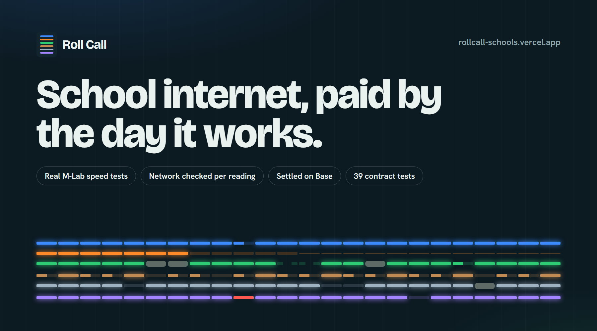
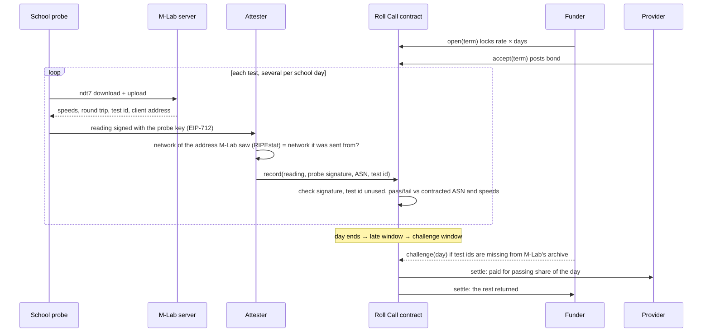

<p align="center">
  <a href="https://rollcall-schools.vercel.app"></a>
</p>

<p align="center">
  <a href="https://rollcall-schools.vercel.app"></a>
  <a href="https://base-sepolia.blockscout.com/address/0x6b5fa7F9bD52D8162bF61D329ca167C5CF069dd5"></a>
  
  
  
</p>

**[Be the school for three minutes](https://rollcall-schools.vercel.app/test)** · **[The live register](https://rollcall-schools.vercel.app/#register)** · **[How a day is decided](https://rollcall-schools.vercel.app/how)** · **[Check it yourself](https://rollcall-schools.vercel.app/verify)**

Roll Call pays a school’s internet provider **only for the school days the line actually worked**. A funder locks a term’s money in a contract. Several times a day, a probe inside the school runs a real [M-Lab](https://www.measurementlab.net/) ndt7 speed test and signs the result. An attester confirms the test ran over the network the provider was paid to run. Each school day is then marked and settled on a public ledger: a working day pays the provider, a dead day goes back to the funder, and repeated outages end the term and cut the provider’s bond.

Built for **Web3 for Social Good 2026** (Singapore Management University, GSR Foundation, University of Málaga), Tech Track.

---

## Why

India’s auditor (CAG Report No. 19 of 2026, performance audit of BharatNet) found the village fibre network **marked service ready in 96.7% of 2.26 lakh village councils, but operational in only 33.2% of those**. Fibre faults took **17 days** on average to restore and caused 48% of downtime ([The Policy Edge’s summary](https://www.policyedge.in/p/bharatnet-faces-major-operational-gaps-despite-near-complete-rural-fibre-coverage)). Where a private operator ran the line under a maintenance contract, 90.1% worked; where a central public-sector company did, 10.7% did.

Schools live with the same gap: a connection is paid for when it is installed or when a month ends, and nobody in the school can say “it was down all week” in a way a payment system will hear. Roll Call makes the school’s own measurement the payment trigger.

## What is real, and what is simulated

| | Real | Simulated |
|---|---|---|
| Contract, money flows, day marks | Every term, on Base Sepolia, with a test dollar | — |
| **Visitor terms** ([/test](https://rollcall-schools.vercel.app/test)) | Real M-Lab ndt7 tests from the visitor’s browser, real network lookup (RIPEstat) | Two-minute school days |
| **Probe 0** | Real M-Lab tests from a cloud server in India, four a day, real calendar, 60-day term | It is a server, not a school |
| **Six demo schools** | Contract logic, signatures, settlement | Their readings: scripted from what breaks school links (fibre cut, floods, slow line, hotspot tests, faked readings). Private ASNs (AS64512+), test ids start with `sim:` |

## How a school day is decided



| Mark | When | Money |
|---|---|---|
| Present | at least `required` passing tests | full day to the provider |
| Partial | some passing tests | that share to the provider, rest to the funder |
| Absent | tests ran, none passed (slow, or over another network) | back to the funder, strike |
| Silent | no test arrived | back to the funder, strike |
| Closed | school signed “closed today” before the day ended | back to the funder, no strike |
| Voided | funder’s challenge upheld by the arbiter | back to the funder, strike, bond cut |

After `strikeLimit` strikes in a row the funder may end the term: unserved days come back with a slice of the bond.

## Contracts (Base Sepolia, verified)

| Contract | Address |
|---|---|
| Roll Call | [`0x6b5fa7F9bD52D8162bF61D329ca167C5CF069dd5`](https://base-sepolia.blockscout.com/address/0x6b5fa7F9bD52D8162bF61D329ca167C5CF069dd5) |
| Test dollar (tUSD, no value) | [`0xA6F6e6Bb1Bc46a54635a417Fc8d601B39BaB3762`](https://base-sepolia.blockscout.com/address/0xA6F6e6Bb1Bc46a54635a417Fc8d601B39BaB3762) |
| House (funder, attester, arbiter for demo terms) | [`0x629239c5b7B7e6E78944DFd8f4D519161BbA79d9`](https://base-sepolia.blockscout.com/address/0x629239c5b7B7e6E78944DFd8f4D519161BbA79d9) |
| Demo provider | [`0x0E82E9f33e83a3be2895b9Fe68b75A735790fD4b`](https://base-sepolia.blockscout.com/address/0x0E82E9f33e83a3be2895b9Fe68b75A735790fD4b) |

## Guarantees and the tests that check them

| Guarantee | Test (`contracts/test/RollCall.t.sol`) |
|---|---|
| The whole term is locked up front | `test_open_locks_the_whole_term` |
| Only the school’s probe key can sign readings | `test_reading_signed_by_another_key_is_rejected` |
| The attester cannot change a signed number | `test_tampered_reading_is_rejected` |
| A reading names the M-Lab test it came from | `test_test_id_must_match_the_mlab_uuid` |
| One test counts once, ever | `test_one_test_cannot_be_counted_twice` |
| A test over another network earns nothing | `test_reading_over_another_network_does_not_count` |
| No late backfill, no future-dated readings | `test_late_reading_is_rejected`, `test_future_reading_is_rejected` |
| Partial days pay pro rata | `test_partial_day_pays_pro_rata_and_refunds_the_rest` |
| Silence is refunded and counted as a strike | `test_silent_day_is_refunded_and_struck` |
| Closures must come before the day ends, signed by the probe | `test_day_cannot_be_closed_after_it_ends`, `test_closure_needs_the_probe_signature` |
| Challenges void days and cut bonds | `test_upheld_challenge_voids_the_day_and_slashes` |
| Repeated outages end the term | `test_terminate_after_strike_limit_returns_unserved_days` |
| Money is never created or lost (500 random terms) | `testFuzz_money_is_conserved` |

```bash
cd contracts && forge test
```

## Gas (measured on this deployment)

| Action | Gas |
|---|---|
| Open a term | 237,850 |
| Accept a term | 74,602 |
| Record one reading | 93,651 |
| Settle one school day | 88,756 |

A school for a year (200 school days, four readings a day batched daily) is about 70 million gas. The [verify page](https://rollcall-schools.vercel.app/verify) prices it live at Base mainnet’s gas price.

## Repository

```
contracts/   Solidity (Foundry): RollCall.sol, TestDollar.sol, 33 tests, deploy script
web/         Next.js 16 app: live register, Be the school, term pages, attester API, keeper
web/lib/ndt7.ts          a small ndt7 client (browser and Node 22), speeds from M-Lab's server-side TCPInfo
web/app/api/reading      the attester: probe signature, M-Lab id and host, network check, record on chain
web/lib/server/keeper.ts the demo schools' clock, settlement, challenges, terminations
web/scripts/probe0.ts    Probe 0, run by cron on a server four times a day
```

Run it locally:

```bash
cd web
npm install
# .env.local: HOUSE_KEY, PROVIDER_KEY (funded on Base Sepolia), KEEPER_SECRET
npm run dev   # http://localhost:3240
```

## Trust model and limits

- **The probe** signs what it measured; its key lives in the school (here: in the visitor’s browser storage).
- **The attester** vouches only for the network a test ran over, and refuses readings sent from a different network than the one M-Lab saw. In this demo one key is the attester; the design calls for a quorum of independent attesters.
- **Speeds are what M-Lab’s server counted**, as reported by the probe. Only M-Lab’s public archive proves they were not edited before signing, which is why the funder has a challenge window.
- **A school colluding with its provider** can still run tests elsewhere on the same network. The archive check, site visits and the bond are the funder’s tools.
- **Test dollars only.** Real terms would use a stablecoin, with a regulated on- and off-ramp for the funder.

M-Lab publishes every test it serves, including the client address, in its open archive. Roll Call writes only a hash of the address on chain.

## Roadmap

1. Read Giga Meter measurements as a second probe source.
2. A quorum of attesters, each checking networks independently.
3. Automatic archive checks that file challenges on their own.
4. A district pilot: 20–50 schools, one term, compared against the provider’s own uptime reports.

## Built for this hackathon

All code here was written on 23–24 October 2026 for Web3 for Social Good 2026.

MIT licensed.
