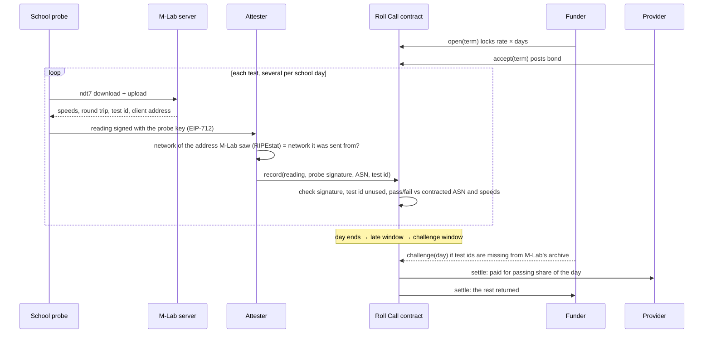

<p align="center">
  <a href="https://rollcall-schools.vercel.app"></a>
</p>

<p align="center">
  <a href="https://rollcall-schools.vercel.app"></a>
  <a href="https://base-sepolia.blockscout.com/address/0xD4EDf73a6604840986C32339A96c8E59cB915984"></a>
  
  
  
</p>

**[Be the school for three minutes](https://rollcall-schools.vercel.app/test)** · **[The live register](https://rollcall-schools.vercel.app/#register)** · **[How a day is decided](https://rollcall-schools.vercel.app/how)** · **[Check it yourself](https://rollcall-schools.vercel.app/verify)**

Roll Call pays a school’s internet provider **only for the school days the line actually worked**. A funder locks a term’s money in a contract. Several times a day, a probe inside the school runs a real [M-Lab](https://www.measurementlab.net/) ndt7 speed test and signs the result. An attester confirms the test ran over the network the provider was paid to run. Each school day is then marked and settled on a public ledger: a working day pays the provider, a dead day goes back to the funder, and repeated outages end the term and cut the provider’s bond.

Built for **Web3 for Social Good 2026** (Singapore Management University, GSR Foundation, University of Málaga), Tech Track.

---

## Use it for a real school

Everything the demo does also works with your own wallets on Base Sepolia:

1. **The school** opens [the probe kit](https://rollcall-schools.vercel.app/probe) on any computer that stays on (lab PC, office laptop, Raspberry Pi). The kit makes a probe key, tests once in each part of the school day, retries every 15 minutes until a test passes, and signs **offline reports** when the line is down, sent when it comes back.
2. **The funder** opens [a term](https://rollcall-schools.vercel.app/open) for that probe address: the provider, the arbiter, the provider’s network, what a working day means, the money. Test dollars come from a built-in faucet.
3. **The provider** accepts from its own wallet on the term page, which also lets the funder challenge or end the term and the arbiter decide challenges.
4. Every term has a printable **statement** and a **CSV** of its register: in *register mode* a treasury that cannot hold stablecoins pays from the statement in its own currency.

## Why

India’s auditor (CAG Report No. 19 of 2026, performance audit of BharatNet) found the village fibre network **marked service ready in 96.7% of 226,000 village councils, but operational in only 33.2% of those**. Fibre faults took **17 days** on average to restore and caused 48% of downtime ([The Policy Edge’s summary](https://www.policyedge.in/p/bharatnet-faces-major-operational-gaps-despite-near-complete-rural-fibre-coverage)). Where a private operator ran the line under a maintenance contract, 90.1% worked; where a central public-sector company did, 10.7% did.

India’s school census has the same blind spot. UDISE+ 2024-25 (Ministry of Education, Table 2.5) records, for 1.47 million schools, whether each has electricity, water, toilets and computers **and whether each of them works**. For internet it records only whether a connection exists: 934,000 schools have one, and **how many of those work on a school day is not recorded anywhere** ([table](https://educationforallinindia.com/wp-content/uploads/2025/10/State-wise-share-of-schools-by-facilities-UDISEPlus-2024-25-Ministry-of-Education.pdf)). Roll Call is that missing column, produced by the school itself, every school day, in a form a payment can follow.

Schools live with the same gap: a connection is paid for when it is installed or when a month ends, and nobody in the school can say “it was down all week” in a way a payment system will hear. Roll Call makes the school’s own measurement the payment trigger.

## What is real, and what is simulated

| | Real | Simulated |
|---|---|---|
| Contract, money flows, day marks | Every term, on Base Sepolia, with a test dollar | — |
| **Visitor terms** ([/test](https://rollcall-schools.vercel.app/test)) | Real M-Lab ndt7 tests from the visitor’s browser, real network lookup (RIPEstat) | Two-minute school days |
| **Probe 0** | Real M-Lab tests from a cloud server in India, four a day, real calendar, 60-day term | It is a server, not a school |
| **Six demo schools** | Contract logic, signatures, settlement | Their readings: scripted from what breaks school links (fibre cut, floods, slow line, hotspot tests, faked readings). Private ASNs (AS64512+), test ids start with `sim:` |

## How a school day is decided



A school’s opening hours each day are split into `required` equal parts; only the first pass in each part counts, so a line that works for half an hour cannot earn a whole day by retrying, and nobody tests at night.

| Mark | When | Money |
|---|---|---|
| Present | a passing test in every part of the day | full day to the provider |
| Partial | passing tests in some parts | that share to the provider, rest to the funder; under half the parts is also a strike |
| Absent | the probe reported (tests failed, ran over another network, or signed “offline”, relayed by phone until the day settles) and nothing passed | back to the funder, strike |
| Silent | nothing reported at all (device off, power cut) | back to the funder, no strike |
| Closed | school signed a closure (one day or a run of up to 31) before any test those days | back to the funder, no strike |
| Voided | funder’s challenge upheld by the arbiter | back to the funder, strike, bond cut |

A challenge stakes a deposit (lost to the provider if it fails) and lapses if the arbiter stays silent, so nobody can freeze a term. After `strikeLimit` strikes in a row the funder may end the term: unserved days come back with a slice of the bond, but any finished day with a passing test settles first. The contract refuses a term where one key holds two roles (funder, provider, probe, attester, arbiter).

## Contracts (Base Sepolia, verified)

| Contract | Address |
|---|---|
| Roll Call v3 | [`0xD4EDf73a6604840986C32339A96c8E59cB915984`](https://base-sepolia.blockscout.com/address/0xD4EDf73a6604840986C32339A96c8E59cB915984) |
| Test dollar (tUSD, no value) | [`0xA6F6e6Bb1Bc46a54635a417Fc8d601B39BaB3762`](https://base-sepolia.blockscout.com/address/0xA6F6e6Bb1Bc46a54635a417Fc8d601B39BaB3762) |
| Attester (records readings, settles, pays visitors’ gas) | [`0x629239c5b7B7e6E78944DFd8f4D519161BbA79d9`](https://base-sepolia.blockscout.com/address/0x629239c5b7B7e6E78944DFd8f4D519161BbA79d9) |
| Funder | [`0xb582FBB0b36365dED379f6B9Bc9AC6f2de4A304B`](https://base-sepolia.blockscout.com/address/0xb582FBB0b36365dED379f6B9Bc9AC6f2de4A304B) |
| Arbiter | [`0xf7ADb15eb48085a35Efb1eb04c946bE4D20e5AcD`](https://base-sepolia.blockscout.com/address/0xf7ADb15eb48085a35Efb1eb04c946bE4D20e5AcD) |
| Demo provider | [`0x0E82E9f33e83a3be2895b9Fe68b75A735790fD4b`](https://base-sepolia.blockscout.com/address/0x0E82E9f33e83a3be2895b9Fe68b75A735790fD4b) |
| Roll Call v2 (retired) | [`0x27500043Bf3A8ae3405264412C2D4D43E8744150`](https://base-sepolia.blockscout.com/address/0x27500043Bf3A8ae3405264412C2D4D43E8744150) |
| Roll Call v1 (retired) | [`0x6b5fa7F9bD52D8162bF61D329ca167C5CF069dd5`](https://base-sepolia.blockscout.com/address/0x6b5fa7F9bD52D8162bF61D329ca167C5CF069dd5) |

v3 followed a second review the same afternoon: parts of the day now divide the school’s opening hours (no testing at night), offline reports may arrive until the day settles (a long fibre cut becomes strikes, not silence), a day passing fewer than half its parts is a strike, and one closure covers a run of days. v1 was replaced that morning after an audit and a mock judging panel found that a funder could end a term before earned days settled, a closure could erase a pass, retrying in one half-hour could earn a full day, one key could hold two roles, and an unresolved challenge could freeze a term. Every one of those is now a test.

## Guarantees and the tests that check them

| Guarantee | Test (`contracts/test/RollCall.t.sol`) |
|---|---|
| The whole term is locked up front | `test_open_locks_the_whole_term` |
| No key may hold two roles | `test_no_key_may_hold_two_roles` |
| Only the school’s probe key can sign readings | `test_reading_signed_by_another_key_is_rejected` |
| The attester cannot change a signed number | `test_tampered_reading_is_rejected` |
| Only the term’s attester records | `test_only_the_terms_attester_records` |
| A reading names the M-Lab tests it came from; each counts once, ever | `test_test_id_must_match_the_mlab_uuid`, `test_one_test_cannot_be_counted_twice` |
| A test over another network earns nothing | `test_reading_over_another_network_does_not_count` |
| Retrying inside one part of the day cannot earn a full day | `test_retrying_inside_one_slot_cannot_earn_a_full_day` |
| A dead line (offline reports) is Absent; a dead device is Silent, with no strike | `test_offline_report_makes_the_day_absent_not_silent`, `test_silent_day_is_refunded_without_a_strike` |
| No backfill, no future-dated readings | `test_late_reading_is_rejected_at_the_settle_boundary`, `test_future_reading_is_rejected` |
| Failing floods are capped, a needed pass never is | `test_cap_stops_failing_floods_but_never_a_needed_pass` |
| Closures only before any test, signed by the probe, never twice | `test_a_day_with_readings_cannot_be_closed`, `test_closure_needs_the_probe_signature`, `test_a_closure_cannot_be_replayed` |
| Challenges: upheld voids and slashes, rejected pays the provider the deposit, silence lapses | `test_upheld_challenge_voids_the_day_slashes_and_returns_the_deposit`, `test_rejected_challenge_pays_as_measured_and_the_deposit_goes_to_the_provider`, `test_a_silent_arbiter_lets_the_challenge_lapse` |
| Repeated absence ends the term, but earned days are paid first | `test_terminate_after_strike_limit_returns_unserved_days`, `test_terminate_waits_until_earned_days_are_settled` |
| Parts divide school hours; a pass at night counts for nothing | `test_parts_divide_school_hours_and_passes_outside_them_do_not_count` |
| Offline reports arrive until the day settles; tests only within the late window | `test_offline_report_arrives_after_the_late_window_but_before_settling`, `test_a_test_with_speeds_still_obeys_the_late_window` |
| A day passing under half its parts is a strike; half or more resets | `test_a_day_passing_fewer_than_half_its_parts_is_a_strike`, `test_a_day_passing_half_or_more_resets_strikes` |
| One closure covers a holiday week, never twice | `test_a_school_closes_a_whole_week_with_one_signature` |
| Money is never created or lost (500 random terms) | `testFuzz_money_is_conserved` |

```bash
cd contracts && forge test
```

## Gas (measured on this deployment)

| Action | Gas |
|---|---|
| Open a term | 265,179 |
| Accept a term | 75,419 |
| Record one reading | about 97,500 |
| Settle one school day | about 89,000 |

A school for a year (200 school days, four readings a day batched daily) is about 72 million gas of execution, plus Base’s small fee for posting data to Ethereum. The [verify page](https://rollcall-schools.vercel.app/verify) prices it live at Base mainnet’s gas price.

## Repository

```
contracts/   Solidity (Foundry): RollCall.sol, TestDollar.sol, 45 tests, deploy script
web/         Next.js 16 app: live register, Be the school, term pages, attester API, keeper
web/lib/ndt7.ts          a small ndt7 client (browser and Node 22), speeds from M-Lab's server-side TCPInfo
web/app/api/reading      the attester: probe signature, M-Lab id and host, network check, record on chain
web/lib/server/keeper.ts the demo schools' clock, settlement, challenges, terminations
web/scripts/probe0.ts    Probe 0, run by cron on a server four times a day
```

Run it locally:

```bash
cd web
npm install
# .env.local: HOUSE_KEY, PROVIDER_KEY (funded on Base Sepolia), KEEPER_SECRET
npm run dev   # http://localhost:3240
```

## Trust model and limits

- **The probe** signs what it measured; its key lives in the school (here: in the visitor’s browser storage).
- **The attester** vouches only for the network a test ran over, and refuses readings sent from a different network than the one M-Lab saw. The contract takes that network number on the attester’s word, so the attester is the trusted party for it; each term names its own, and the next step is a quorum of independent attesters. In this demo the four role keys are separate but held by one server, and the attester is also the key that relays gas and mints test dollars.
- **Speeds are what M-Lab’s server counted**, as reported by the probe. Only M-Lab’s public archive proves they were not edited before signing, which is why the funder has a challenge window.
- **A school colluding with its provider** can still run tests elsewhere on the same network. The archive check, site visits and the bond are the funder’s tools.
- **Test dollars only.** Real terms would use a stablecoin, with a regulated on- and off-ramp for the funder.

M-Lab publishes every test it serves, including the client address, in its open archive, and visitors agree to that before testing. Roll Call writes only a salted hash of the address on chain.

## Roadmap

1. Read Giga Meter measurements as a second probe source.
2. A quorum of attesters, each checking networks independently.
3. Automatic archive checks that file challenges on their own.
4. A district pilot: 20–50 schools, one term, compared against the provider’s own uptime reports.

## Built for this hackathon

All code here was written on 23–24 October 2026 for Web3 for Social Good 2026.

MIT licensed.
